<p align="center">
  
</p>

<h1 align="center">Coinvane</h1>

<p align="center">
  <b>Read the market's direction.</b><br/>
  Live prices for 500+ coins in your own currency and language, real charts, price alerts, portfolio and a home screen widget.
</p>

<p align="center">
  <a href="https://play.google.com/store/apps/details?id=com.abraxel.cryptocurrency"></a>
  
  
  
  <a href="https://www.youtube.com/watch?v=O6LOn6S6Vr0"></a>
</p>

<p align="center">
  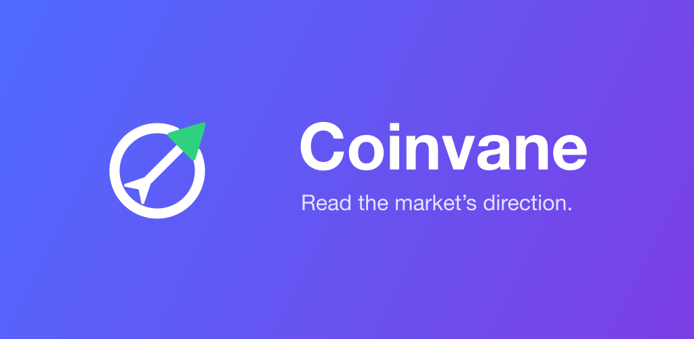
</p>

## Screenshots

<p align="center">
  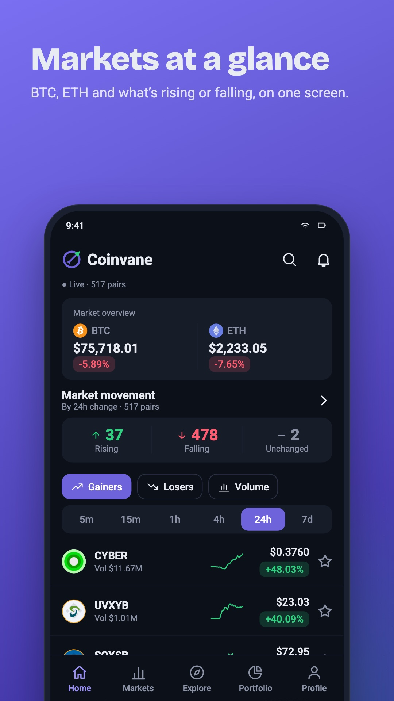
  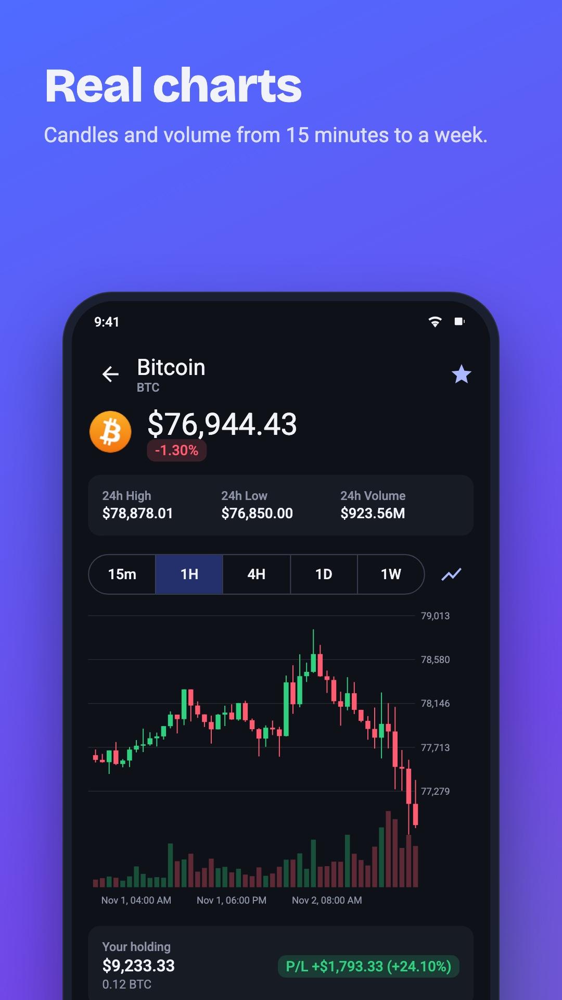
  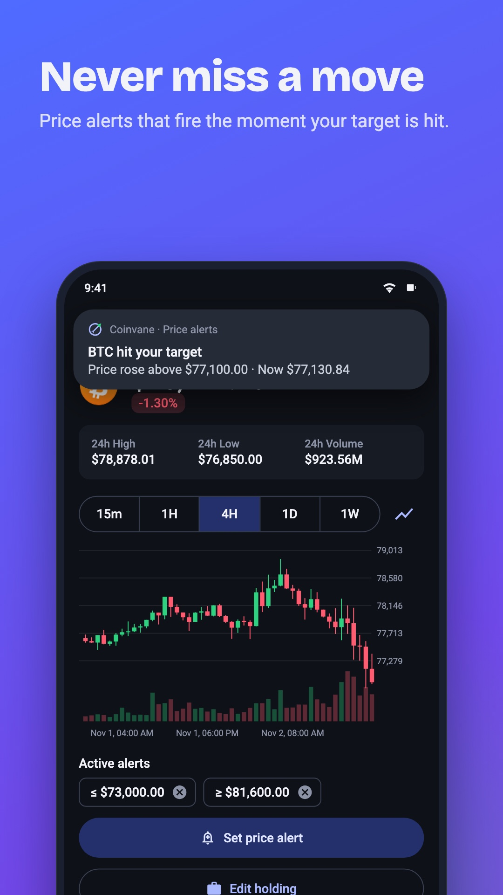
</p>
<p align="center">
  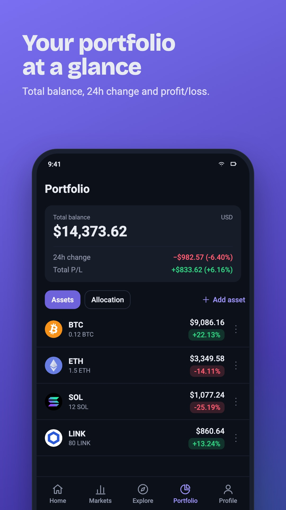
  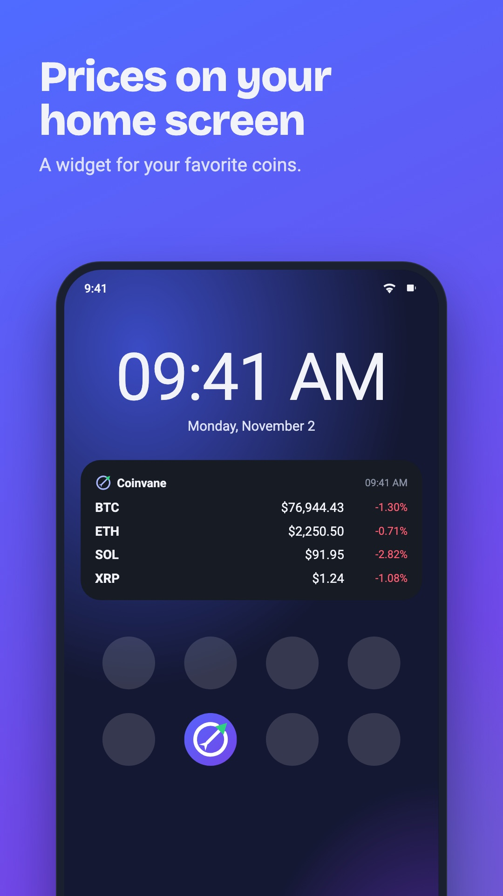
  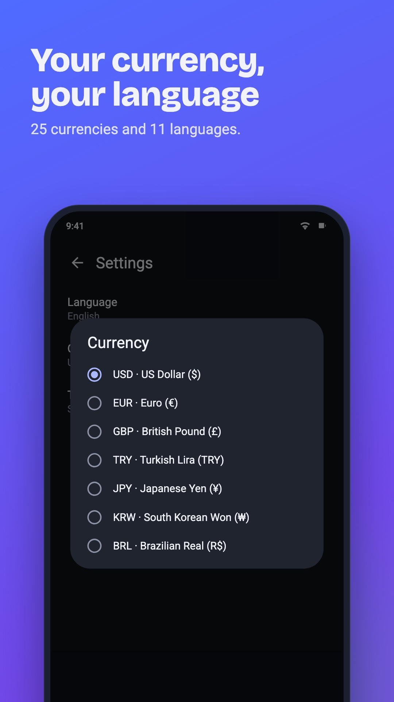
</p>

<details>
<summary><b>Tablet screenshots</b> (7" and 10")</summary>
<br/>
<p align="center">
  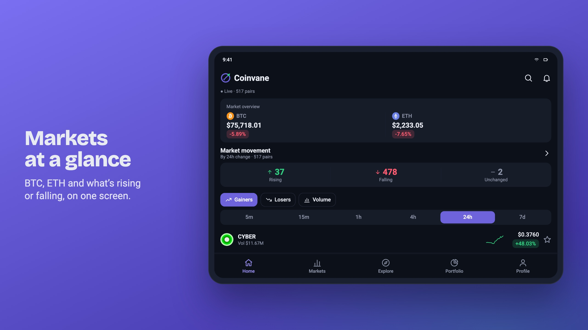
  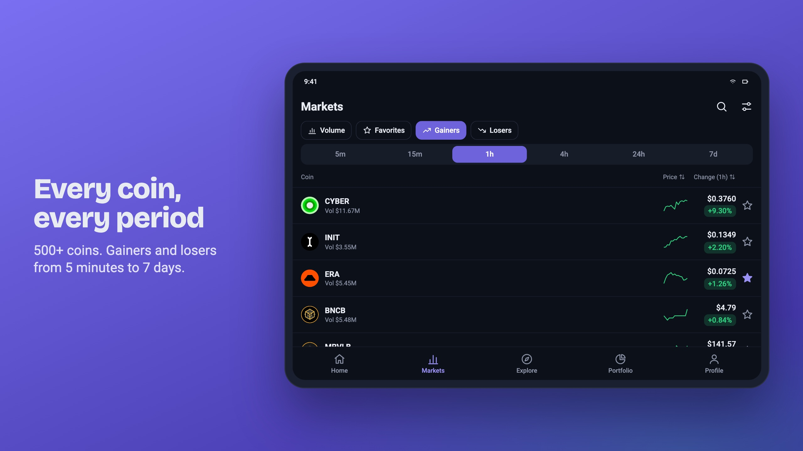
  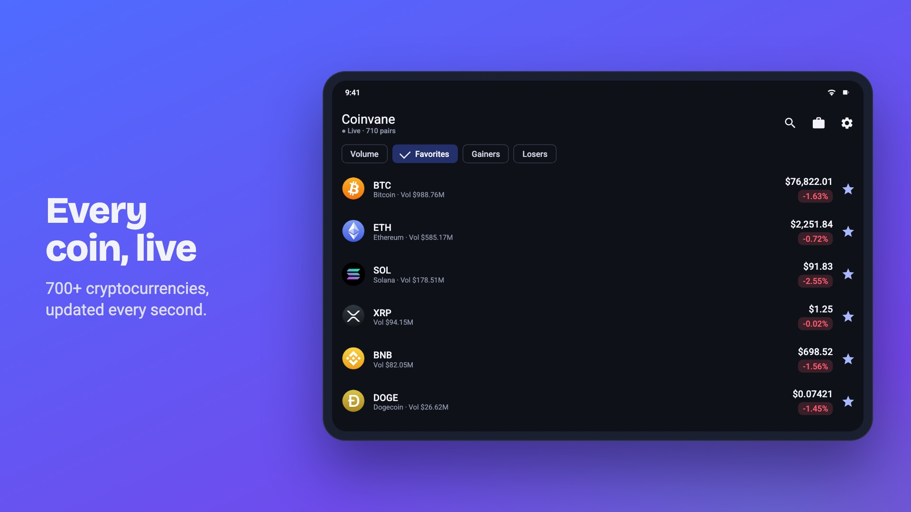
  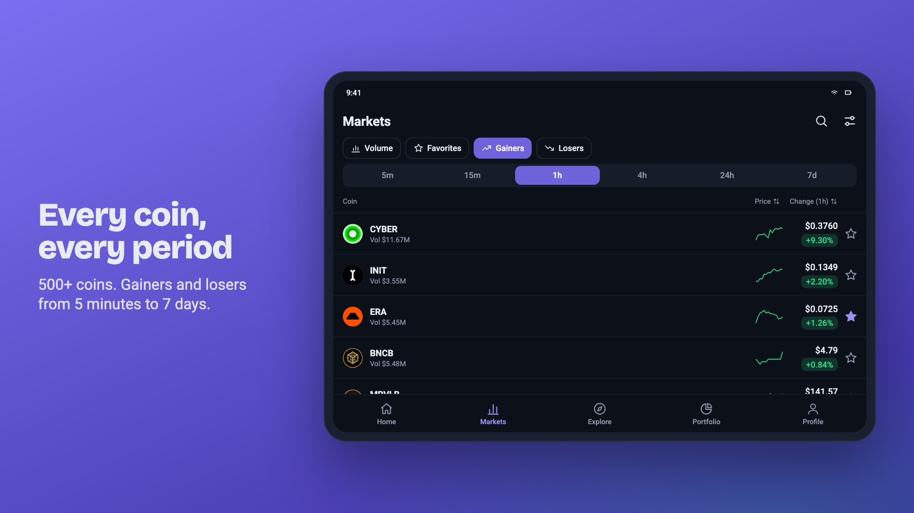
</p>
</details>

Localized screenshots for all 11 languages live under [`fastlane/metadata/android/`](fastlane/metadata/android).

## Features

- **Live prices** — WebSocket subscriptions only for the coins on screen (mobile-data friendly); the list refreshes every second
- **25 currencies** (USD, EUR, TRY, GBP, JPY, KRW, BRL, INR…) — picked from the device region on first launch
- **11 languages** — English, Turkish, German, French, Spanish, Portuguese (BR), Russian, Arabic (RTL), Japanese, Korean, Chinese;
  selectable in the app or from Android 13+ system settings
- **Charts** — candles or line + volume bars, 15m / 1h / 4h / 1D / 1W, live last candle
- **Price alerts** — instant while the app is open, ~every 15 minutes when closed (WorkManager)
- **Portfolio** — amount + average buy price → total balance, 24h change, profit/loss
- **Widget** — your favorite coins (BTC, ETH, SOL, BNB by default)
- Favorites, gainers/losers, search, light/dark theme, Material You colors

## Data sources (free, no API key)

| Purpose | Endpoint |
| --- | --- |
| 24h tickers, candles | `https://data-api.binance.vision/api/v3/` (USDT pairs) |
| Live stream | `wss://data-stream.binance.vision/stream` |
| FX rates (USD based, daily) | `https://open.er-api.com/v6/latest/USD` — attributed in Settings |
| Coin logos | CoinCap CDN, fallback spothq/cryptocurrency-icons (jsDelivr) |

## Tech stack

Plain **Java 17**, View XML + ViewBinding, **Material 3**, OkHttp (REST + WebSocket), MPAndroidChart, WorkManager,
AppCompat per-app languages. Gradle 9.8 / AGP 9.5, compileSdk/targetSdk 37, minSdk 26.

```
app/src/main/java/com/abraxel/cryptocurrency/
├── data/        Binance REST + parsers, PriceSocket, Fx rates, Money formatting, Store, Settings
├── alerts/      Alerts.check() on live ticks + PriceAlertWorker
├── portfolio/   Holding, Totals, PortfolioActivity
├── chart/       CandleChart (candles/line + volume)
└── widget/      PriceWidget + UpdateWorker
```

All prices are kept in USD (USDT) internally; conversion and locale formatting happen only in `data/Money`.

## Build

Requirements: JDK 17+, Android SDK (platform 37).

```bash
./gradlew testDebugUnitTest   # unit tests
./gradlew lintDebug           # lint
./gradlew assembleDebug       # debug APK
./gradlew bundleRelease       # Play Store AAB
```

GitHub Actions ([`.github/workflows/android.yml`](.github/workflows/android.yml)) runs tests, lint and builds on every push / PR.

- **Release signing** — copy `keystore.properties.example` to `keystore.properties` and fill it in. That file and `*.jks`
  are gitignored; without it `bundleRelease` produces an unsigned AAB.
- **Crashlytics** — drop the Firebase `google-services.json` into `app/`; without it Firebase is not compiled in.

## Store assets

- Play Store texts in 11 languages: `fastlane/metadata/android/` (fastlane `supply` format)
- Logo and graphics sources (SVG): `design/`
- `python3 design/store/render.py` — per language: 6 phone (1080×1920), 6 × 7" (1920×1080) and 6 × 10" (2560×1440) screenshots,
  rendered with live Binance prices, real BTC candles and the app's own `strings.xml`, each country in its own currency
- `python3 design/store/listings.py` — title, short/full description and localized feature graphic for all 11 languages
- Trailer (English, 30 s): https://www.youtube.com/watch?v=O6LOn6S6Vr0

See [`Changelog.txt`](Changelog.txt) for release notes.
